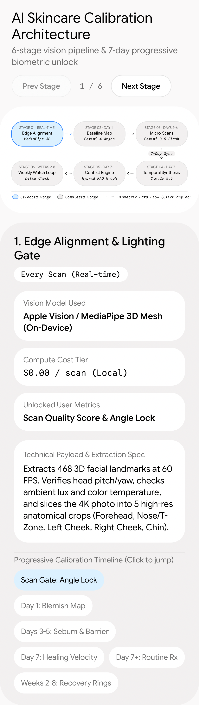

# Draft 1.0: Skin Calibration (7-day scan + paid 3D scan)

**Status:** parked, not designed in the app, not built. **Held:** excluded from "deploy all drafts".
**Trigger to revisit:** Skintel Stripe revenue reaches $5,000 (see `README.md`), or the founder asks.

Source: an AI chat suggestion the founder pasted, plus the founder's own additions below. Model names and
specs in the chat output have **not** been checked against this repo (`api/_ai.ts`) or real vendor docs.

## Idea

Like a smartwatch or Whoop, the app needs about a week of scans before it unlocks the full picture.
One selfie is misleading (yellow light, hot shower, sweat). Scanning over days filters out the noise.

Pitch to the user: "3 of 7 scans done. Barrier health unlocks at 5."

## 6-stage pipeline (from the pasted architecture image)

| # | When | Stage | Model (as written, unverified) | Unlocks |
|---|---|---|---|---|
| 1 | Every scan, real time | Edge alignment + lighting gate | Apple Vision / MediaPipe 3D mesh, on device, $0 | Scan quality score, angle lock |
| 2 | Day 1 | Baseline map | Gemini 4 Argon | Skin type estimate, hydration snapshot, blemish count |
| 3 | Days 2-6 | Micro-scans | Gemini 3.5 Flash | Sebum profile (3 days), barrier and redness baseline (5 days) |
| 4 | Day 7 | Temporal synthesis | Claude 5.5 | Healing velocity, full report |
| 5 | Day 7+ | Conflict engine | Hybrid rules + RAG graph | Routine Rx that avoids clashing actives |
| 6 | Weeks 2-8 | Weekly watch loop | Delta check | Recovery rings |

Stage 1 detail: landmarks and head pitch/yaw, ambient light and colour temperature check, then cut the photo
into 5 crops (forehead, nose/T-zone, left cheek, right cheek, chin).

Daily scan output: a strict JSON log per zone, each scored 0-100 on `erythema_index`, `shine_sebum_level`,
`comedone_count`, `inflammatory_lesion_count`, `texture_roughness`. Light is normalised using the whites of the
eyes or a neutral background patch. Day 7 analyses the time series. Rules, not the model, block clashing
actives (never retinol + glycolic in the same week for a low barrier score).

## Founder additions

### 1. Paid-plan feature, not onboarding
Don't put it in onboarding. When someone buys Skintel+, offer it as a feature: "Scan your face for a full 3D
read of your skin."

### 2. Questionnaire after the scan
- **Quick path: 6-7 questions.** The essentials. Skin type is the most basic one; keep it in case it isn't
  already known.
- Then ask: "Want to go deeper?" **Deep path: up to 18-22 questions, hard cap 22.** Don't tire people out.
  A little long is fine if it feels worthwhile.
- Every question has preset options to choose from. A question can also be **pick one, then "add more
  detail"** (free text).
- Show progress. Let people skip and come back.

### 3. Human review option (unsure, wait)
After sensitive answers, ask: "Something you're uncomfortable with? Want a person to look at this instead of
the AI?" The founder isn't sure it makes sense. **Leave it out of any first build.**

## Things to settle before building

- **Biometric and health data.** A 3D face scan is sensitive. It needs explicit consent, a privacy policy
  update, App Privacy answers, a deletion path, and a retention rule. App Review already rejected twice and
  asked about data collection (5.1.1). Read `docs/APP_REVIEW_NOTES.md` first. Apple has extra rules for face
  data from ARKit/TrueDepth; check them before using it.
- **Human review** means staff read someone's face photos and health answers. That needs staffing, access
  control, a policy and disclosure, and it isn't free. Park it.
- **Device support.** "Full 3D" may need a TrueDepth camera. Check what Apple Vision gives on older phones.
  Landmark counts and frame rates in the pasted text are unverified.
- **Cost.** Scans every day for 7 days across a stage-2 to stage-4 model stack costs real money per user.
  Work out cost per user against the $8.99 monthly price, and decide what free users see.
- **Native build.** MediaPipe in a Swift 6 app with no Mac and CI as the only compiler is risky. Prefer
  Apple's own frameworks.
- **Copy rule conflict.** Today verdicts do **not** use skin type or age (only Ask Skintel does). This
  feature would use a skin profile. Decide where it feeds in; don't write copy that contradicts either.
- **Model names.** Confirm which models exist and are routed in `api/_ai.ts`, and update the routing table in
  `CLAUDE.md` if this ships.
- **Brand.** Skintel design system, no yellow, one mascot per screen. Design it on the canvas before any code.
